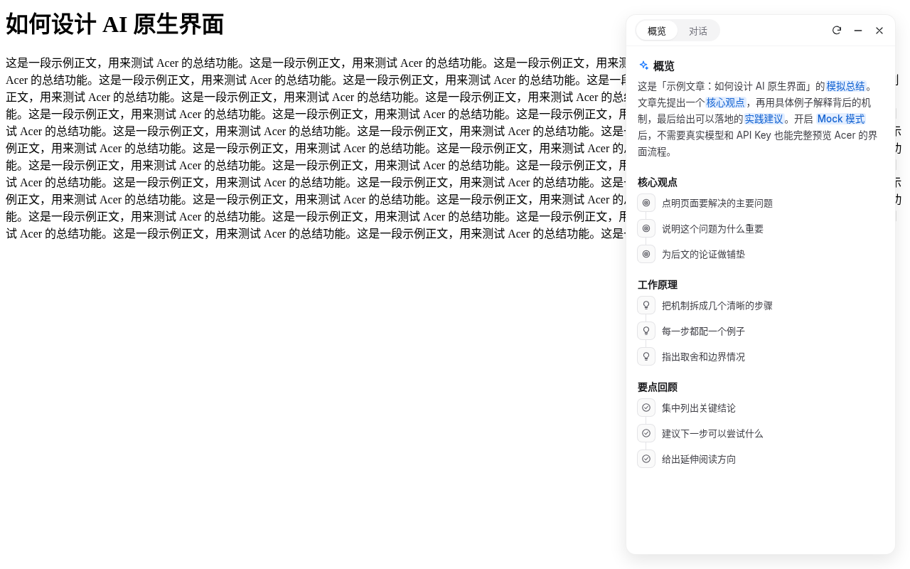
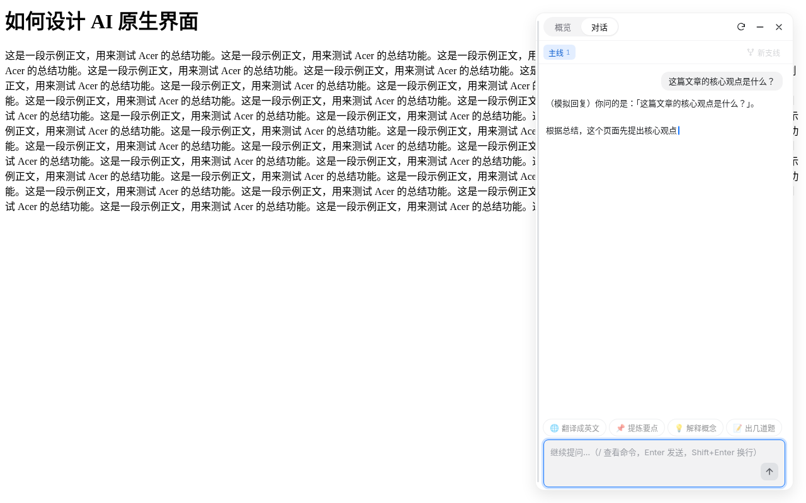
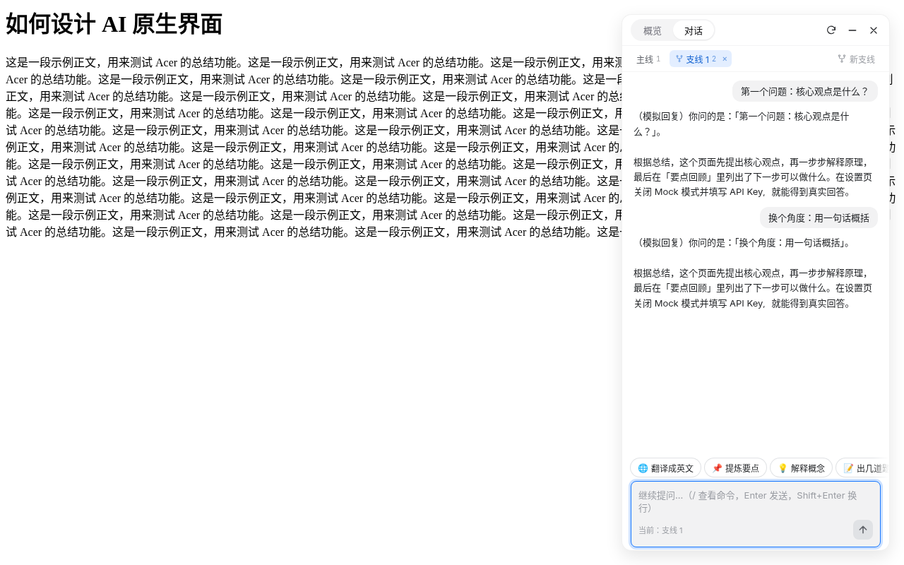
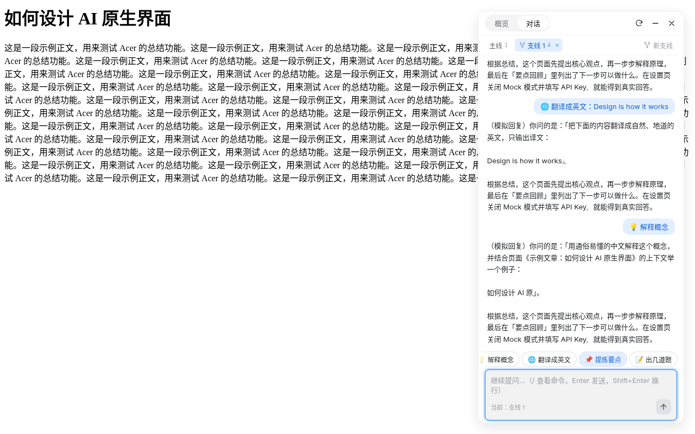
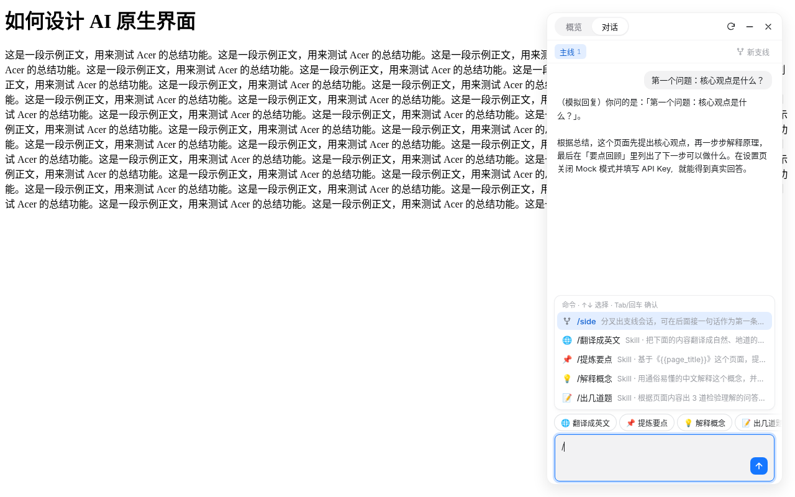
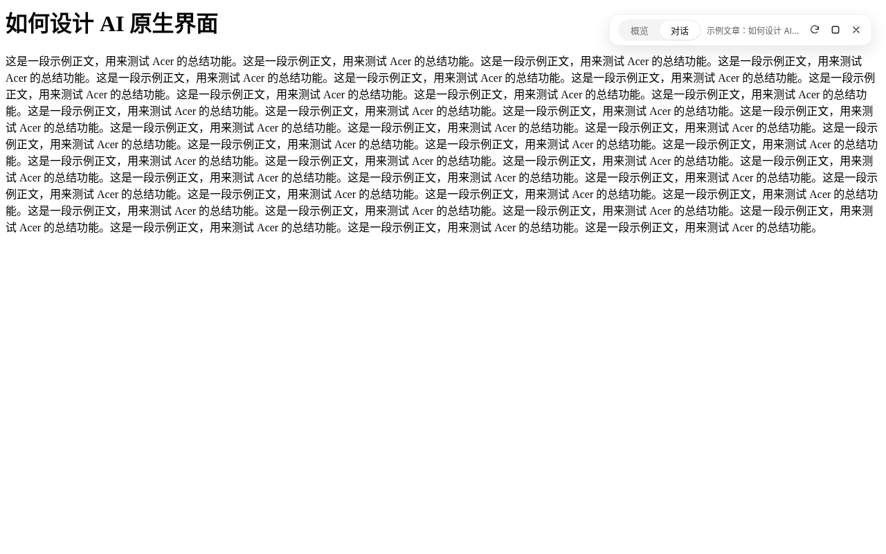
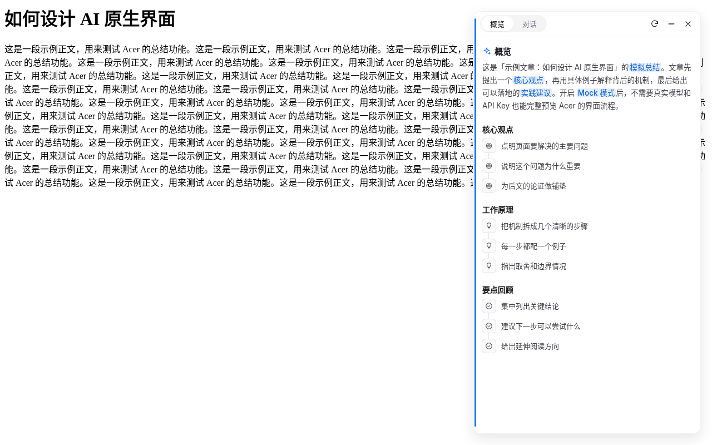
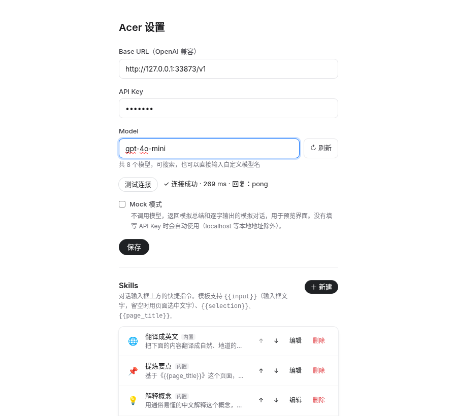
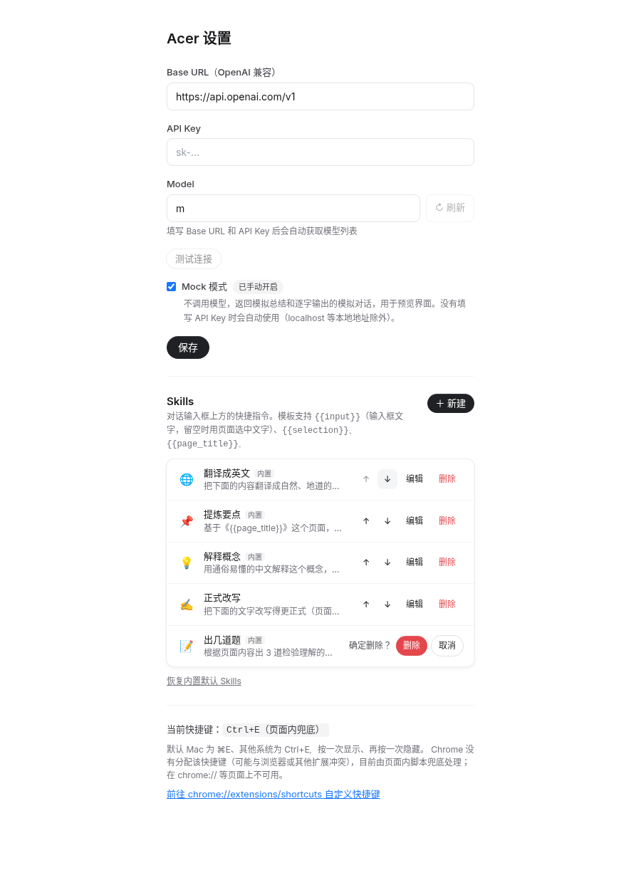

<div align="center">

# Representer

**网页 AI 总结 · 思维导图大纲 · 继续对话 —— 开源、BYOK 的 Chrome 扩展**

[](./LICENSE)
[](https://developer.chrome.com/docs/extensions/develop/migrate/what-is-mv3)
[](https://react.dev)
[](https://wxt.dev)



</div>

> **Representer** is an open-source **Chrome extension** that turns any web page into an **AI summary**, a **mind-map outline** and a follow-up **chat**. It is **BYOK** (bring your own key): it works with any OpenAI-compatible API (OpenAI, OpenRouter, DeepSeek, Ollama…), and all data stays in your browser.

## 目录
- [功能](#功能) · [截图](#截图) · [快速开始](#快速开始) · [配置](#配置) · [开发](#开发) · [常见问题与限制](#常见问题与限制) · [许可与致谢](#许可与致谢)

## 功能

- 🧠 **AI 总结 + 思维导图大纲**：用 [defuddle](https://github.com/kepano/defuddle) 提取正文，由大模型生成概览、关键词高亮和分节大纲树。
- 💬 **继续对话**：基于总结和原文追问，回复逐字流式输出，对话按页面保存。
- 🌿 **支线会话 `/side`**：把当前对话分叉成独立支线，主线和支线可随时切换、关闭。
- ⚡ **自定义 Skills**：把常用提示词做成一键按钮，支持 `{{input}}` / `{{selection}}` / `{{page_title}}` 占位符，按最近使用排序。
- 🗂️ **24 小时缓存**：同一页面 24 小时内直接读缓存，不重复消耗 token；可手动「重新总结」。
- ⌨️ **快捷键唤起**：`⌘E` / `Ctrl+E` 切换浮层，带弹簧滑入动画；支持最小化、拖拽调整宽度（320–640px，自动记忆）。
- 🔑 **BYOK，隐私优先**：请求由扩展后台直接发往你配置的接口，不经过任何第三方服务器。
- 🧪 **Mock 模式**：不填 Key 也能完整体验界面。

## 截图

| 流式对话 | 支线会话 | Skills 快捷按钮 |
| :---: | :---: | :---: |
|  |  |  |
| **斜杠命令** | **最小化** | **拖拽调整宽度** |
|  |  |  |
| **模型列表与测试连接** | **Skills 管理** | |
|  |  | |

## 快速开始

```bash
git clone https://github.com/Yaphet2015/Representer.git
cd Representer
npm install
npm run build        # 产物在 .output/chrome-mv3
```

1. 打开 `chrome://extensions`，开启右上角「开发者模式」。
2. 点击「加载已解压的扩展程序」，选择 `.output/chrome-mv3`。
3. 打开扩展的「选项」页，填写 Base URL、API Key 并选择模型（见下方[配置](#配置)）。
4. 在任意网页按 **`⌘E`（Mac）/ `Ctrl+E`（Windows/Linux）** 或点击工具栏图标，打开 Representer。

> **快捷键说明**：可在 `chrome://extensions/shortcuts` 自定义。Chrome 可能拒绝分配与浏览器自带快捷键冲突的组合（例如 Linux 上的 `Ctrl+E`），此时 Representer 会在页面内兜底监听 `⌘E` / `Ctrl+E`。兜底只在普通网页生效，`chrome://` 页面和 Chrome 应用商店中不可用；Mac 上 `⌘E` 会覆盖「用所选内容查找」。

## 配置

| 选项 | 说明 |
| --- | --- |
| **Base URL** | 任意 OpenAI 兼容接口，如 `https://api.openai.com/v1`、`https://openrouter.ai/api/v1`、本地 Ollama `http://localhost:11434/v1`（本地地址可不填 Key） |
| **API Key** | 只保存在本机 `chrome.storage.local` |
| **Model** | 填好 Base URL 和 Key 后自动从 `GET /models` 拉取，可搜索，也可直接输入自定义模型名 |
| **测试连接** | 向所选模型发送一条极短请求，显示成功与耗时或错误信息 |
| **Mock 模式** | 返回模拟总结和逐字输出的模拟回复；未填 Key 时自动启用（本地地址除外） |

**Skills**：在选项页新增、编辑、删除、排序。模板占位符：

| 占位符 | 含义 |
| --- | --- |
| `{{input}}` | 输入框中的文字（为空时使用页面选中文字） |
| `{{selection}}` | 页面上最近选中的文字 |
| `{{page_title}}` | 当前页面标题 |

内置 Skills：翻译成英文、提炼要点、解释概念、出几道题。在对话框输入 `/` 可查看全部命令。

## 开发

```bash
npm run dev       # 开发模式（热更新，自动打开带扩展的 Chrome）
npm run build     # 生产构建
npm run compile   # TypeScript 类型检查
npm test          # Vitest 单元测试
npm run zip       # 打包 zip
```

技术栈：WXT · React · TypeScript · Tailwind CSS · Framer Motion · Shadow DOM · [pi durable](https://github.com/earendil-works/pi)（OpenAI 兼容 `/chat/completions`）

```
entrypoints/   扩展入口：background（后台消息与流式对话）、content（Shadow DOM 浮层）、options（设置页）
components/    UI 组件（浮层、对话、Skills、模型选择等）；bui/ 为改编自 Beautiful UI 的基础组件
lib/           纯逻辑：缓存、会话、Skills、消息协议、存储、Mock、模型调用、解析
tests/         Vitest 单元测试
verify/        Puppeteer 端到端验证脚本与截图
```

## 常见问题与限制

- **数据存在哪里？** 设置、总结缓存、对话和 Skills 都在浏览器本地 `chrome.storage.local`，不会上传。
- **支持哪些模型？** 任何兼容 OpenAI `/chat/completions` 的服务；总结需要模型能稳定输出 JSON。
- **为什么某些页面打不开浮层？** Chrome 不允许扩展在 `chrome://`、Chrome 应用商店等页面注入脚本。
- **长文章会截断吗？** 正文会截断到一定长度后再发送给模型，以控制 token 消耗。
- **重新总结会怎样？** 会忽略缓存重新生成，并清空该页面的对话。

## 许可与致谢

- 基于 [MIT License](./LICENSE) 开源。
- 部分 UI 组件（Button、Shimmer、LoadingState、对话输入框、流式光标、设计 token）改编自 [Beautiful UI](https://www.beautifului.dev)（MIT），源码位于 `components/bui/` 和 `assets/beautifui.css`。
- 正文提取使用 [defuddle](https://github.com/kepano/defuddle)。
